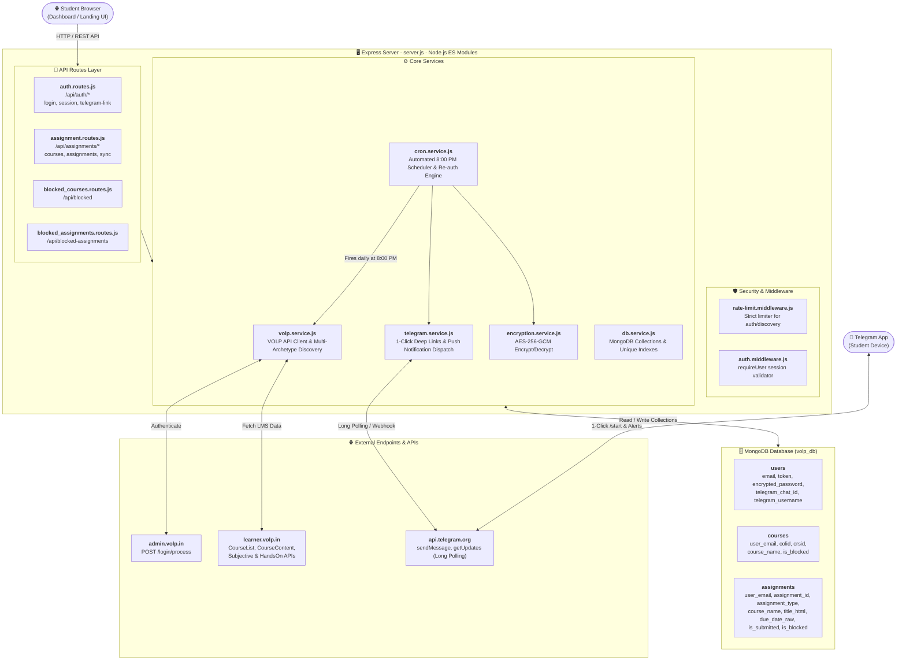

# VOLP Assignment Reminder — Full-Stack Web Application & Telegram Bot

A production-ready **Node.js (ES Modules) + Express + MongoDB** application that automates assignment tracking, provides granular mute/block controls, and delivers daily automated assignment digests directly to students via **Telegram Bot** (with zero-friction 1-click deep linking) and an interactive web dashboard.

---

## ⚡ Key Highlights & Capabilities

- 🤖 **Zero-Friction 1-Click Telegram Deep Linking**: Students connect their Telegram in one tap via deep link (`https://t.me/<bot>?start=<token>`). Long-polling automatically detects and binds the student's `chat_id` and `@username` in real time.
- ⏰ **Automated Daily 8:00 PM Reminder Dispatch**: A background cron engine aggregates all active pending assignments across enrolled courses and sends a unified digest directly to the student's Telegram.
- 🔐 **AES-256-GCM Credential Security**: User passwords are encrypted at rest using AES-256-GCM with unique initialization vectors (IV) and authentication tags, allowing seamless headless re-authentication when session tokens expire during cron jobs.
- 📚 **Comprehensive 6-Archetype Assignment Discovery**: Deep traversal across Course, Unit, and Topic levels, extracting Subjective, Hands-On, and Quiz/Project tasks from live VOLP LMS endpoints.
- 🚫 **Granular Muting / Block Management**: Block entire courses or individual assignments from alerts. Blocked items are strictly omitted from automated reminders, manual tests, and dashboard counts.
- 🖥️ **Modern Dark-Mode Dashboard**: Features live sync, assignments view with status filters, enrolled courses explorer, calendar deadline tracker, blocked items manager, reminder logs, and account configuration.
- 🛡️ **Security & Rate Limiting**: Tiered IP rate limiting on authentication and assignment discovery endpoints protects against abusive traffic.

---

## 🏗️ System Architecture



---

## 🗺️ Sequence Flow Diagrams

---

### UC-1 · 1-Click Telegram Deep Link Connection

```text
  Student (UI)              Express Server (auth.controller)      Telegram Bot API         Student's Telegram App
       │                                   │                              │                           │
       │  Click "Connect Telegram"         │                              │                           │
       │  POST /api/auth/telegram-link-token                              │                           │
       │──────────────────────────────────▶│                              │                           │
       │                                   │  Generate 15-min token       │                           │
       │                                   │  Save to users collection    │                           │
       │  Return { linkUrl: "t.me/bot?start=TOKEN" }                      │                           │
       │◀──────────────────────────────────│                              │                           │
       │                                                                  │                           │
       │  Opens deep link in Telegram app ────────────────────────────────┼──────────────────────────▶│
       │                                                                  │                           │
       │                                                                  │  Taps [START]             │
       │                                                                  │  Sends "/start TOKEN"     │
       │                                   │                              │◀──────────────────────────│
       │                                   │  Long-polling getUpdates     │                           │
       │                                   │  receives { chat, text }     │                           │
       │                                   │◀─────────────────────────────│                           │
       │                                   │                                                          │
       │                                   │  Verify token in DB                                      │
       │                                   │  Update user: set chat_id, username, clear token        │
       │                                   │  Send welcome confirmation ─────────────────────────────▶│ (Receives welcome)
       │                                   │                                                          │
       │  HTTP polling detects active chat_id                                                         │
       │  UI displays "✓ Connected: @username"                                                       │
       │◀──────────────────────────────────│                                                          │
```

---

### UC-2 · User Login & Encrypted Credential Persistence

```text
  Student (UI)              auth.controller.js            volp.service.js       encryption.service.js      MongoDB (users)
       │                            │                            │                       │                        │
       │  POST /api/auth/login      │                            │                       │                        │
       │  { username, password }    │                            │                       │                        │
       │───────────────────────────▶│                            │                       │                        │
       │                            │  loginVOLP(u, pwd)         │                       │                        │
       │                            │───────────────────────────▶│                       │                        │
       │                            │                            │  POST admin.volp.in   │                        │
       │                            │                            │  /login/process       │                        │
       │                            │                            │───────────────────────▶ (VOLP API)             │
       │                            │                            │◀─────────────────────── { token }              │
       │                            │◀───────────────────────────│                       │                        │
       │                            │  return session token      │                       │                        │
       │                            │                                                    │                        │
       │                            │  encrypt(password)                                 │                        │
       │                            │───────────────────────────────────────────────────▶│                        │
       │                            │◀───────────────────────────────────────────────────│                        │
       │                            │  returns iv:authTag:ciphertext                     │                        │
       │                            │                                                    │                        │
       │                            │  upsertUser(email, token, encrypted_password)                               │
       │                            │────────────────────────────────────────────────────────────────────────────▶│
       │                            │◀────────────────────────────────────────────────────────────────────────────│
       │  HTTP 200 { user, token }  │                                                                             │
       │◀───────────────────────────│                                                                             │
```

---

### UC-3 · Automated Daily 8:00 PM Telegram Reminder Dispatch

```text
  node-cron                 cron.service.js          MongoDB (users/courses)     volp.service.js      telegram.service.js
     │                             │                           │                        │                      │
     │  Fires daily at 8:00 PM     │                           │                        │                      │
     │  (CRON_SCHEDULE)            │                           │                        │                      │
     │────────────────────────────▶│                           │                        │                      │
     │                             │  Query registered users   │                        │                      │
     │                             │──────────────────────────▶│                        │                      │
     │                             │◀──────────────────────────│                        │                      │
     │                             │  For each user:           │                        │                      │
     │                             │  - Load blocked courses   │                        │                      │
     │                             │  - Load blocked asgns     │                        │                      │
     │                             │                                                    │                      │
     │                             │  fetchUserAssignments(token, email, blockedColids) │                      │
     │                             │───────────────────────────────────────────────────▶│                      │
     │                             │  [If session expired (HTTP 401/HTML)]:             │                      │
     │                             │    decrypt(user.encrypted_password)                │                      │
     │                             │    re-authenticate with loginVOLP()                │                      │
     │                             │    update user token in DB                         │                      │
     │                             │    retry fetchUserAssignments()                    │                      │
     │                             │◀───────────────────────────────────────────────────│                      │
     │                             │  returns assignments[]                             │                      │
     │                             │                                                    │                      │
     │                             │  Filter pending & unblocked items                  │                      │
     │                             │  sendAssignmentReminderTelegram(email, list, chat) │                      │
     │                             │──────────────────────────────────────────────────────────────────────────▶│
     │                             │                                                    │                      │  Format HTML digest
     │                             │                                                    │                      │  POST /sendMessage
     │                             │                                                    │                      │──────────────────▶ (Telegram)
     │                             │◀──────────────────────────────────────────────────────────────────────────│  return success
```

---

### UC-4 · Assignment Sync & Multi-Archetype Discovery

```text
  volp.service.js
        │
        │  fetchUserAssignments(token, email, blockedColids)
        │
        ├─▶ POST /learnerCourseDashboard/learnerCourseList ──▶ returns courses[]
        │
        └─▶ for each enrolled course in courses[]:
                  │
                  ├─ Is course colid in blockedColids?
                  │       YES ──▶ 🚫 Skip entire course
                  │       NO  ──▶ Continue
                  │
                  ├─▶ POST /learnerCourseContent/courseContentData ──▶ returns unit_level[]
                  │
                  ├─▶ [ARCHETYPE 1: SUBJECTIVE (Course-Level)]
                  │       POST /SubjectiveAssignment/getSubjectiveAssignment_new
                  │       └─ question_list[] ──▶ push normalized { type: "SUBJECTIVE", ... }
                  │
                  ├─▶ [ARCHETYPE 2: HANDS-ON (Unit-Level)]
                  │       If unit_level.length > 0:
                  │       For each unit in unit_level[]:
                  │           POST /HandOnAssignment/getHandsOnDetails
                  │           └─ ass_list[] ──▶ push normalized { type: "HANDS_ON", ... }
                  │
                  └─▶ [ARCHETYPES 3–6: Topic-Level & Deep Units]
                          Parses recursive content nodes for embedded assignments,
                          quizzes, and interactive projects.
        │
        └─ return assignments[] (all discovered assignments merged and normalized)
```

---

## 🗄️ MongoDB Database Collections

The database `volp_db` consists of three collections with strict unique indexes to guarantee idempotent synchronization.

### 1. `users` collection
Stores authenticated learner profiles, session credentials, encrypted passwords, and Telegram binding metadata.

| Field | Type | Description |
|---|---|---|
| `email` | String | **Unique Index**. Primary university email identifier. |
| `token` | String | Active VOLP session bearer token. |
| `encrypted_password` | String | Format `iv:authTag:ciphertext` (AES-256-GCM) for background cron auto-relogin. |
| `telegram_chat_id` | String | Bound Telegram chat ID for direct push notifications. |
| `telegram_username` | String | Bound Telegram username handle (e.g. `ashik_hegde`). |
| `telegram_link_token` | String | Ephemeral 1-click connection token. Cleared upon binding. |
| `telegram_link_expires` | Date | Expiration timestamp for the 1-click token (15-minute window). |
| `created_at` | Date | Account initial registration timestamp. |
| `updated_at` | Date | Last profile / session update timestamp. |

### 2. `courses` collection
Caches enrolled courses and tracks course-level mute/block state.

| Field | Type | Description |
|---|---|---|
| `user_email` | String | Owning student's email. |
| `colid` | Number | VOLP course offering ID (`colid`). |
| `crsid` | Number | VOLP course catalog ID (`crsid`). |
| `course_name` | String | Clean course code and title label. |
| `semester` | String | Semester label (e.g. `Fall Semester 2025-26`). |
| `academic_year` | String | Academic calendar year. |
| `is_blocked` | Boolean | `true` if course alerts are muted; `false` otherwise. |
| `blocked_at` | Date | Timestamp when blocked; `null` if active. |
| `updated_at` | Date | Timestamp of last synchronization. |

> **Compound Unique Index:** `{ user_email: 1, colid: 1 }`

### 3. `assignments` collection
Caches all fetched assignments and tracks per-assignment mute/block status and completion.

| Field | Type | Description |
|---|---|---|
| `user_email` | String | Owning student's email. |
| `assignment_id` | Number | VOLP assignment primary identifier. |
| `assignment_type` | String | Assignment archetype (`SUBJECTIVE`, `HANDS_ON`, etc.). |
| `colid` | Number | Associated course offering ID. |
| `course_name` | String | Associated course title. |
| `unit_name` | String | Unit name (for Hands-On tasks). |
| `title_html` | String | Cleaned assignment question / prompt text. |
| `due_date_raw` | String | Due date as reported by the LMS API. |
| `is_submitted` | Boolean | Submission status (`true` if already submitted). |
| `is_blocked` | Boolean | `true` if this specific assignment is muted. |
| `blocked_at` | Date | Timestamp when muted; `null` if active. |
| `updated_at` | Date | Timestamp of last synchronization. |

> **Compound Unique Index:** `{ user_email: 1, assignment_id: 1, assignment_type: 1 }`

---

## 🌐 API Reference

All requests require `Content-Type: application/json`. Protected endpoints require an active session (validated via user email and token headers/body).

### Authentication & Telegram Integration (`/api/auth`)

| Method | Endpoint | Access | Description |
|---|---|---|---|
| `POST` | `/api/auth/login` | Public | Authenticates against VOLP, encrypts password, upserts user in MongoDB. |
| `GET` | `/api/auth/session` | Public | Returns active session state from client cookies / headers. |
| `POST` | `/api/auth/logout` | Public | Clears session and logs out user. |
| `POST` | `/api/auth/telegram-link-token` | Protected | Generates an ephemeral 1-click Telegram deep link URL with 15-minute validity. |
| `GET` | `/api/auth/telegram-status` | Protected | Polls current Telegram connection status (`connected`, `chat_id`, `username`). |
| `POST` | `/api/auth/telegram-chat-id` | Protected | Manually sets or updates Telegram chat ID. |
| `POST` | `/api/auth/telegram-disconnect` | Protected | Unlinks Telegram chat ID and username from the user account. |
| `GET` | `/api/auth/telegram-config` | Public | Returns public bot username and configuration. |

### Assignments & Courses (`/api/assignments`)

| Method | Endpoint | Access | Description |
|---|---|---|---|
| `GET/POST` | `/api/assignments/my-courses` | Protected | Retrieves cached courses for the user. |
| `POST` | `/api/assignments/sync-courses` | Protected | Live sync: fetches latest course list from VOLP LMS and updates MongoDB. |
| `GET/POST` | `/api/assignments/my-assignments`| Protected | Retrieves cached assignments for the user. |
| `POST` | `/api/assignments/sync-assignments`| Protected | Live sync: triggers deep discovery of assignments across all non-blocked courses. |
| `POST` | `/api/assignments/trigger-8pm-reminder` | Protected | Simulates the 8:00 PM reminder run immediately and dispatches Telegram notification. |

### Block Management (`/api/blocked` & `/api/blocked-assignments`)

| Method | Endpoint | Access | Description |
|---|---|---|---|
| `GET` | `/api/blocked?email=...` | Protected | Retrieves list of all blocked courses for the student. |
| `POST` | `/api/blocked` | Protected | Toggles course block state (`is_blocked: true/false`). |
| `GET` | `/api/blocked-assignments?email=...` | Protected | Retrieves list of all muted assignments for the student. |
| `POST` | `/api/blocked-assignments` | Protected | Toggles assignment block state (`is_blocked: true/false`). |

---

## ⚙️ Environment Configuration (`.env`)

Create a `.env` file in the `mainprojectprototype/` folder based on `.env.example`:

| Variable | Required | Default | Description |
|---|---|---|---|
| `PORT` | Optional | `4000` | HTTP port for the Express application. |
| `NODE_ENV` | Optional | `development` | Runtime environment (`development` / `production`). |
| `VOLP_LOGIN_URL` | **Yes** | — | VOLP login processing endpoint (`https://admin.volp.in/login/process`). |
| `VOLP_LEARNER_URL` | **Yes** | — | VOLP learner root API (`https://learner.volp.in`). |
| `MONGODB_URI` | **Yes** | `mongodb://127.0.0.1:27017` | MongoDB connection URI. |
| `MONGODB_DB_NAME` | Optional | `volp_db` | MongoDB database name. |
| `TELEGRAM_BOT_TOKEN` | **Yes** | — | Telegram Bot API token obtained from `@BotFather`. |
| `TELEGRAM_CHAT_ID` | Optional | — | Fallback Telegram chat ID for admin alerts. |
| `CRON_SCHEDULE` | Optional | `0 20 * * *` | Cron schedule expression (Default: Every day at 8:00 PM). |
| `CRON_TIMEZONE` | Optional | `Asia/Kolkata` | IANA timezone for cron execution. |
| `ENCRYPTION_KEY` | **Yes** | — | 64-character hexadecimal key (32 bytes) for AES-256-GCM encryption. |
| `TEST_VOLP_EMAIL` | Optional | — | Used exclusively for end-to-end integration tests. |
| `TEST_VOLP_PASSWORD` | Optional | — | Used exclusively for end-to-end integration tests. |

> [!TIP]
> **Generating an Encryption Key:**
> ```bash
> node -e "console.log(crypto.randomBytes(32).toString('hex'))"
> ```

---

## 🚀 Quickstart & Setup Guide

### 1. Prerequisites
- **Node.js**: `v18.0.0` or higher (supports native `fetch` and top-level `await`).
- **MongoDB**: `v6.0+` running locally (`mongodb://127.0.0.1:27017`) or a remote MongoDB Atlas URI.
- **Telegram Account**: To receive assignment reminders.

### 2. Installation
```bash
# Navigate to the project directory
cd mainprojectprototype

# Install production and development dependencies
npm install
```

### 3. Telegram Bot Creation (Takes 30 seconds)
1. Open Telegram and search for **`@BotFather`**.
2. Send `/newbot` and follow the prompts to choose a name and username (e.g., `MyVolpReminderBot`).
3. Copy the **HTTP API Bot Token** provided by BotFather.
4. Paste the token into your `.env` file as `TELEGRAM_BOT_TOKEN`.

### 4. Configure Environment
```bash
cp .env.example .env
nano .env   # Or open in your code editor and populate your keys
```

### 5. Start the Server
```bash
# Production start
npm start

# Development mode with auto-reload (nodemon)
npm run dev
```

Open **[http://localhost:4000](http://localhost:4000)** in your browser.

---

## 🧪 Testing & Verification

The test suite includes comprehensive unit and integration tests using Jest:

```bash
# Run unit tests (Telegram service, Cron service, Encryption, Database)
node --experimental-vm-modules node_modules/jest/bin/jest.js tests/unit.telegram.service.test.js tests/unit.cron.service.test.js tests/unit.encryption.service.test.js

# Run full test suite
npm test
```

### Test Coverage Highlights:
- **`unit.telegram.service.test.js`**: Validates 1-click token generation, deep link URL building, `/start <token>` incoming message handler, message escaping, and push notifications.
- **`unit.cron.service.test.js`**: Validates automated scheduling, user iteration, course/assignment block filtering, token expiration auto-relogin, and error handling.
- **`unit.encryption.service.test.js`**: Validates AES-256-GCM encryption, decryption, authentication tag tampering detection, and key derivation.
- **`unit.db.service.test.js`**: Validates MongoDB index creation and collection connectivity using in-memory MongoDB.

---

## 📁 Repository Structure

```text
mainprojectprototype/
├── server.js                         # Application entrypoint & Express server initialization
├── package.json                     # Dependencies, scripts, and Jest configuration
├── .env.example                     # Environment template with all required keys
├── routes/                          # Express route definitions
│   ├── auth.routes.js               # Login, session, logout, Telegram 1-click binding
│   ├── assignment.routes.js         # Course & assignment fetch, live sync, manual dispatch
│   ├── blocked_courses.routes.js    # Course block/unblock toggles
│   └── blocked_assignments.routes.js# Assignment block/unblock toggles
├── controllers/                     # Route handler controllers
│   ├── auth.controller.js           # Authentication and Telegram deep link controllers
│   ├── assignment.controller.js     # Assignment and course synchronization controllers
│   ├── blocked_courses.controller.js
│   └── blocked_assignments.controller.js
├── middleware/                      # HTTP middlewares
│   ├── auth.middleware.js           # requireUser authentication guard
│   └── rate-limit.middleware.js     # IP rate limiters for auth and API discovery
├── services/                        # Business logic & integrations
│   ├── db.service.js                # MongoDB connection and unique compound indexes
│   ├── volp.service.js              # VOLP login & 6-archetype assignment discovery
│   ├── cron.service.js              # Daily 8:00 PM automated cron job with auto-relogin
│   ├── telegram.service.js          # Telegram Bot API, 1-click deep links, long polling
│   └── encryption.service.js        # AES-256-GCM encryption/decryption utilities
├── tests/                           # Unit and integration test suites
│   ├── unit.telegram.service.test.js
│   ├── unit.cron.service.test.js
│   ├── unit.encryption.service.test.js
│   ├── unit.db.service.test.js
│   ├── unit.volp.service.test.js
│   └── integration.test.js
└── public/                          # Frontend single-page application
    ├── index.html                   # Student dashboard console HTML
    ├── dashboard.html               # Synced dashboard view
    ├── login.html                   # Standalone login view
    ├── landing.html                 # Marketing landing page
    ├── css/styles.css               # Glassmorphic dark theme stylesheet
    └── js/app.js                    # Frontend reactive state management & UI rendering
```

---

## 🔒 Security Best Practices

1. **Password Safety**: Passwords are never stored in plaintext. They are encrypted using AES-256-GCM and used strictly in memory when background token refreshment is needed.
2. **Ephemeral Link Tokens**: Telegram deep linking tokens expire automatically after 15 minutes and are single-use.
3. **Mute Isolation**: Blocked courses and assignments are evaluated server-side and filtered before dispatching any Telegram notification.
4. **Environment Isolation**: `.env` is strictly gitignored to prevent accidental credential leakage.
