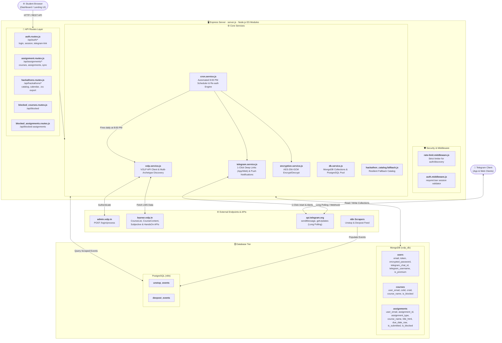

# VOLP Assignment Reminder & Hackathon Intelligence Hub

A production-ready **Node.js (ES Modules) + Express + MongoDB + PostgreSQL** web application and automated **Telegram Bot** designed for university students. It automates course assignment discovery from the VOLP LMS, provides granular mute/block controls, delivers daily 8:00 PM IST deadline alerts to Telegram (with 1-click deep linking for both Mobile/Desktop App and Telegram Web), and features a curated **Hackathon & Competition Intelligence Hub** with interactive deadline calendars and 1-click batch iCalendar (`.ics`) export.

---

## ⚡ Key Highlights & Capabilities

- 🤖 **Zero-Friction 1-Click Telegram Linking (App & Web)**: Students connect Telegram in one tap using secure ephemeral deep links (`https://t.me/<bot>?start=<token>` or `https://web.telegram.org/k/#?tgaddr=...`). Real-time long polling automatically detects and binds the student's `chat_id` and `@username`. Direct bot chat links are readily accessible.
- ⏰ **Automated Daily 8:00 PM Reminder Dispatch**: A background cron engine aggregates all active pending assignments across enrolled courses and sends a unified digest directly to the student's Telegram.
- 🏆 **Hackathon & Event Intelligence Hub (Premium Feature)**: Multi-platform aggregator tracking hackathons and competitions from **Unstop** and **Devpost** via automated n8n PostgreSQL pipelines with resilient built-in fallback catalog.
  - **Lifecycle Phases**: Closing Soon (< 48h), Ongoing (This Week), Upcoming (This Month), Future (30+ Days), and Concluded.
  - **Multi-Dimensional Filters**: Platform tabs (All, Unstop, Devpost), participation mode pills (All, Online, Offline), fee filter (Free/Paid), category/theme, and custom deadline date range.
  - **Interactive Deadline Calendar**: Month grid view, day drawer modal, and 1-Click batch **iCalendar (`.ics`) export** for seamless sync with Google Calendar, Apple Calendar, and Outlook.
- 🎨 **Adaptive Dual-Theme Engine (Dark Obsidian & Crisp White Theme)**: Complete dark and light theme system with high-contrast accessibility, featuring a signature ambient glowing obsidian/lime hero banner (`.calendar-hero`) consistent across both themes.
- 🔐 **AES-256-GCM Credential Security**: User passwords are encrypted at rest using AES-256-GCM with unique initialization vectors (IV) and authentication tags, allowing seamless headless re-authentication when session tokens expire during cron jobs.
- 📚 **Comprehensive 6-Archetype Assignment Discovery**: Deep traversal across Course, Unit, and Topic levels, extracting Subjective, Hands-On, and Quiz/Project tasks from live VOLP LMS endpoints.
- 🚫 **Granular Muting / Block Management**: Block entire courses or individual assignments from alerts. Blocked items are strictly omitted from automated reminders, manual tests, and dashboard counts.
- 🖥️ **Modern Single-Page Dashboard**: Live sync, assignments view with status filters, enrolled courses explorer, calendar deadline tracker, blocked items manager, clean human-friendly reminder logs, and account configuration.
- 🛡️ **Security & Rate Limiting**: Tiered IP rate limiting on authentication and assignment discovery endpoints, plus `x-admin-secret` authentication for developer admin operations.

---

## 🏗️ System Architecture



---

## 🗺️ Sequence Flow Diagrams

### UC-1 · 1-Click Telegram Deep Link Connection (App & Web)

```text
  Student (UI)              Express Server (auth.controller)      Telegram Bot API         Student's Telegram (App / Web)
       │                                   │                              │                           │
       │  Click "Connect (App)" / (Web)    │                              │                           │
       │  POST /api/auth/telegram-link-token                              │                           │
       │──────────────────────────────────▶│                              │                           │
       │                                   │  Generate 15-min token       │                           │
       │                                   │  Save to users collection    │                           │
       │  Return { linkUrl, webUrl }       │                              │                           │
       │◀──────────────────────────────────│                              │                           │
       │                                                                  │                           │
       │  Opens deep link in Telegram App or Web K ───────────────────────┼──────────────────────────▶│
       │                                                                  │                           │
       │                                                                  │  Taps [START]             │
       │                                                                  │  Sends "/start TOKEN"     │
       │                                   │                              │◀──────────────────────────│
       │                                   │  Long-polling getUpdates     │                           │
       │                                   │  receives { chat, text }     │                           │
       │                                   │◀─────────────────────────────│                           │
       │                                   │                                                          │
       │                                   │  Verify token in DB                                      │
       │                                   │  Update user: set chat_id, username, clear token        │
       │                                   │  Send welcome confirmation ─────────────────────────────▶│ (Receives confirmation)
       │                                   │                                                          │
       │  HTTP polling detects active chat_id                                                         │
       │  UI displays "✓ Connected: @username"                                                       │
       │◀──────────────────────────────────│                                                          │
```

---

### UC-2 · Automated Daily 8:00 PM Telegram Reminder Dispatch

```text
  node-cron                 cron.service.js          MongoDB (users/courses)     volp.service.js      telegram.service.js
     │                             │                           │                        │                      │
     │  Fires daily at 8:00 PM     │                           │                        │                      │
     │  (CRON_SCHEDULE)            │                           │                        │                      │
     │────────────────────────────▶│                           │                        │                      │
     │                             │  Query registered users   │                        │                      │
     │                             │──────────────────────────▶│                        │                      │
     │                             │◀──────────────────────────│                        │                      │
     │                             │  For each user:           │                        │                      │
     │                             │  - Load blocked courses   │                        │                      │
     │                             │  - Load blocked asgns     │                        │                      │
     │                             │                                                    │                      │
     │                             │  fetchUserAssignments(token, email, blockedColids) │                      │
     │                             │───────────────────────────────────────────────────▶│                      │
     │                             │  [If session expired (HTTP 401/HTML)]:             │                      │
     │                             │    decrypt(user.encrypted_password)                │                      │
     │                             │    re-authenticate with loginVOLP()                │                      │
     │                             │    update user token in DB                         │                      │
     │                             │    retry fetchUserAssignments()                    │                      │
     │                             │◀───────────────────────────────────────────────────│                      │
     │                             │  returns assignments[]                             │                      │
     │                             │                                                    │                      │
     │                             │  Filter pending & unblocked items                  │                      │
     │                             │  sendAssignmentReminderTelegram(email, list, chat) │                      │
     │                             │──────────────────────────────────────────────────────────────────────────▶│
     │                             │                                                    │                      │  Format HTML digest
     │                             │                                                    │                      │  POST /sendMessage
     │                             │                                                    │                      │──────────────────▶ (Telegram)
     │                             │◀──────────────────────────────────────────────────────────────────────────│  return success
```

---

### UC-3 · Hackathon Intelligence Catalog & 1-Click iCal Calendar Export

```text
  Student (UI)              hackathons.controller.js           db.service.js (PostgreSQL)      Fallback Catalog
       │                               │                                     │                          │
       │  GET /api/hackathons?phase=...│                                     │                          │
       │──────────────────────────────▶│                                     │                          │
       │                               │  Query unstop_events & devpost      │                          │
       │                               │────────────────────────────────────▶│                          │
       │                               │◀────────────────────────────────────│                          │
       │                               │  [If DB empty / connection fails]:                             │
       │                               │  load resilient catalog fallback ─────────────────────────────▶│
       │                               │◀───────────────────────────────────────────────────────────────│
       │                               │                                                                │
       │                               │  Normalize dates, calculate phase statistics                   │
       │  HTTP 200 { events, meta }    │                                                                │
       │◀──────────────────────────────│                                                                │
       │                                                                                                │
       │  Select events & Click "EXPORT ICAL"                                                           │
       │  POST /api/hackathons/export-calendar { event_ids }                                            │
       │──────────────────────────────▶│                                                                │
       │                               │  Build RFC 5545 iCalendar payload (VEVENT with VALARM triggers)│
       │  HTTP 200 (hackathons.ics)    │                                                                │
       │◀──────────────────────────────│                                                                │
       │  Browser downloads .ics file ──▶ Import directly to Google / Apple Calendar / Outlook         │
```

---

## 🗄️ Database Tier

The primary database is **MongoDB** (`volp_db`), with an optional **PostgreSQL** pool for n8n hackathon scrapers.

### 1. `users` collection (MongoDB)
Stores authenticated learner profiles, session credentials, encrypted passwords, and Telegram binding metadata.

| Field | Type | Description |
|---|---|---|
| `email` | String | **Unique Index**. Primary university email identifier. |
| `token` | String | Active VOLP session bearer token. |
| `encrypted_password` | String | Format `iv:authTag:ciphertext` (AES-256-GCM) for background cron auto-relogin. |
| `telegram_chat_id` | String | Bound Telegram chat ID for direct push notifications. |
| `telegram_username` | String | Bound Telegram username handle (e.g. `ashik_hegde`). |
| `telegram_link_token` | String | Ephemeral 1-click connection token. Cleared upon binding. |
| `telegram_link_expires` | Date | Expiration timestamp for the 1-click token (15-minute window). |
| `is_premium` | Boolean | Premium feature flag (unlocks Hackathon intelligence hub). |
| `created_at` | Date | Account initial registration timestamp. |
| `updated_at` | Date | Last profile / session update timestamp. |

### 2. `courses` collection (MongoDB)
Caches enrolled courses and tracks course-level mute/block state.

| Field | Type | Description |
|---|---|---|
| `user_email` | String | Owning student's email. |
| `colid` | Number | VOLP course offering ID (`colid`). |
| `crsid` | Number | VOLP course catalog ID (`crsid`). |
| `course_name` | String | Clean course code and title label. |
| `semester` | String | Semester label (e.g. `Fall Semester 2025-26`). |
| `academic_year` | String | Academic calendar year. |
| `is_blocked` | Boolean | `true` if course alerts are muted; `false` otherwise. |
| `blocked_at` | Date | Timestamp when blocked; `null` if active. |
| `updated_at` | Date | Timestamp of last synchronization. |

> **Compound Unique Index:** `{ user_email: 1, colid: 1 }`

### 3. `assignments` collection (MongoDB)
Caches all discovered assignments and tracks per-assignment mute/block status and completion.

| Field | Type | Description |
|---|---|---|
| `user_email` | String | Owning student's email. |
| `assignment_id` | Number | VOLP assignment primary identifier. |
| `assignment_type` | String | Assignment archetype (`SUBJECTIVE`, `HANDS_ON`, etc.). |
| `colid` | Number | Associated course offering ID. |
| `course_name` | String | Associated course title. |
| `unit_name` | String | Unit name (for Hands-On tasks). |
| `title_html` | String | Cleaned assignment question / prompt text. |
| `due_date_raw` | String | Due date as reported by the LMS API. |
| `is_submitted` | Boolean | Submission status (`true` if already submitted). |
| `is_blocked` | Boolean | `true` if this specific assignment is muted. |
| `blocked_at` | Date | Timestamp when muted; `null` if active. |
| `updated_at` | Date | Timestamp of last synchronization. |

> **Compound Unique Index:** `{ user_email: 1, assignment_id: 1, assignment_type: 1 }`

---

## 🌐 API Reference

All requests require `Content-Type: application/json`. Protected endpoints require an active session validated via email and token.

### Authentication & Telegram Integration (`/api/auth`)

| Method | Endpoint | Access | Description |
|---|---|---|---|
| `POST` | `/api/auth/login` | Public | Authenticates against VOLP, encrypts password, upserts user in MongoDB. |
| `GET` | `/api/auth/session` | Public | Returns active session state from client cookies / headers. |
| `POST` | `/api/auth/logout` | Public | Clears session and logs out user. |
| `POST` | `/api/auth/telegram-link-token` | Protected | Generates an ephemeral 1-click Telegram deep link URL for App and Web. |
| `GET` | `/api/auth/telegram-status` | Protected | Polls current Telegram connection status (`connected`, `chat_id`, `username`). |
| `POST` | `/api/auth/telegram-chat-id` | Protected | Manually sets or updates Telegram chat ID. |
| `POST` | `/api/auth/telegram-disconnect` | Protected | Unlinks Telegram chat ID and username from the user account. |
| `GET` | `/api/auth/telegram-config` | Public | Returns public bot username and configuration. |
| `POST` | `/api/auth/set-premium` | Admin | Toggles `is_premium` flag for a user via `x-admin-secret` header. |

### Assignments & Courses (`/api/assignments`)

| Method | Endpoint | Access | Description |
|---|---|---|---|
| `GET/POST` | `/api/assignments/my-courses` | Protected | Retrieves cached courses for the user. |
| `POST` | `/api/assignments/sync-courses` | Protected | Live sync: fetches latest course list from VOLP LMS and updates MongoDB. |
| `GET/POST` | `/api/assignments/my-assignments`| Protected | Retrieves cached assignments for the user. |
| `POST` | `/api/assignments/sync-assignments`| Protected | Live sync: triggers deep discovery of assignments across all non-blocked courses. |
| `POST` | `/api/assignments/trigger-8pm-reminder` | Protected | Simulates the 8:00 PM reminder run immediately and dispatches Telegram notification. |

### Block Management (`/api/blocked` & `/api/blocked-assignments`)

| Method | Endpoint | Access | Description |
|---|---|---|---|
| `GET` | `/api/blocked?email=...` | Protected | Retrieves list of all blocked courses for the student. |
| `POST` | `/api/blocked` | Protected | Toggles course block state (`is_blocked: true/false`). |
| `GET` | `/api/blocked-assignments?email=...` | Protected | Retrieves list of all muted assignments for the student. |
| `POST` | `/api/blocked-assignments` | Protected | Toggles assignment block state (`is_blocked: true/false`). |

### Hackathon & Event Intelligence (`/api/hackathons`)

| Method | Endpoint | Access | Description |
|---|---|---|---|
| `GET` | `/api/hackathons` | Protected (Premium) | Filterable catalog with platform, phase, fee, theme, date range, and search. |
| `POST`| `/api/hackathons/pipeline/sync` | Protected (Premium / Admin) | Live Devpost & Unstop ingestion pipeline: scrapes & upserts events into PostgreSQL. |
| `GET` | `/api/hackathons/catalog` | Protected (Premium) | Full catalog with phase statistics (closing soon, ongoing, upcoming, etc.). |
| `GET` | `/api/hackathons/calendar` | Protected (Premium) | Calendar deadline events formatted for month/day calendar view. |
| `POST` | `/api/hackathons/export-calendar` | Protected (Premium) | Generates and downloads RFC 5545 `.ics` file for selected events. |

---

## ⚙️ Environment Configuration (`.env`)

Create a `.env` file in the project root directory based on `.env.example`:

| Variable | Required | Default | Description |
|---|---|---|---|
| `PORT` | Optional | `4000` | HTTP port for the Express application. |
| `NODE_ENV` | Optional | `development` | Runtime environment (`development` / `production`). |
| `VOLP_LOGIN_URL` | **Yes** | `https://admin.volp.in/login/process` | VOLP authentication endpoint. |
| `VOLP_LEARNER_URL` | **Yes** | `https://learner.volp.in` | VOLP learner root API. |
| `MONGODB_URI` | **Yes** | `mongodb://127.0.0.1:27017` | MongoDB connection URI. |
| `MONGODB_DB_NAME` | Optional | `volp_db` | MongoDB database name. |
| `TELEGRAM_BOT_TOKEN` | **Yes** | — | Telegram Bot API token obtained from `@BotFather`. |
| `TELEGRAM_CHAT_ID` | Optional | — | Fallback Telegram chat ID for admin notifications. |
| `CRON_SCHEDULE` | Optional | `0 20 * * *` | Cron schedule expression (Default: Every day at 8:00 PM). |
| `CRON_TIMEZONE` | Optional | `Asia/Kolkata` | IANA timezone for cron execution. |
| `ENCRYPTION_KEY` | **Yes** | — | 64-character hexadecimal key (32 bytes) for AES-256-GCM encryption. |
| `POSTGRES_HOST` | Optional | `localhost` | PostgreSQL host for n8n scrapers (Supabase/local). |
| `POSTGRES_PORT` | Optional | `5432` | PostgreSQL port. |
| `POSTGRES_DB` | Optional | `n8n` | PostgreSQL database name. |
| `POSTGRES_USER` | Optional | `postgres` | PostgreSQL user. |
| `POSTGRES_PASSWORD` | Optional | — | PostgreSQL password. |
| `POSTGRES_SSL` | Optional | `false` | Enable SSL for hosted PostgreSQL providers. |
| `ADMIN_SECRET` | Optional | — | Secret token for `/api/auth/set-premium` admin endpoint. |
| `TEST_VOLP_EMAIL` | Optional | — | Used exclusively for end-to-end integration tests. |
| `TEST_VOLP_PASSWORD` | Optional | — | Used exclusively for end-to-end integration tests. |

> [!TIP]
> **Generate an AES-256-GCM Encryption Key:**
> ```bash
> node -e "console.log(crypto.randomBytes(32).toString('hex'))"
> ```

---

## 🚀 Quickstart & Setup Guide

### 1. Prerequisites
- **Node.js**: `v18.0.0` or higher (ES Modules, native `fetch`).
- **MongoDB**: `v6.0+` running locally or a MongoDB Atlas connection.
- **Telegram Account**: To receive assignment reminders.
- **PostgreSQL** *(Optional)*: For live n8n hackathon scrapers (built-in fallback activates automatically if omitted).

### 2. Installation
```bash
# Navigate to the project directory
cd mainprojectprototype

# Install dependencies
npm install
```

### 3. Telegram Bot Setup (Takes 30 seconds)
1. Open Telegram and search for **`@BotFather`**.
2. Send `/newbot` and choose a display name and username (e.g. `volp_remainder_bot`).
3. Copy the **HTTP API Bot Token**.
4. Paste it into your `.env` as `TELEGRAM_BOT_TOKEN`.

### 4. Configure Environment
```bash
cp .env.example .env
nano .env   # Populate your TELEGRAM_BOT_TOKEN and ENCRYPTION_KEY
```

### 5. Start the Server
```bash
# Development mode with auto-reload
npm run dev

# Production start
npm start
```

Open **[http://localhost:4000](http://localhost:4000)** in your browser.

---

## 🧪 Testing & Verification

```bash
# Run unit tests
npm test

# Run specific unit test suites
node --experimental-vm-modules node_modules/jest/bin/jest.js tests/unit.telegram.service.test.js tests/unit.cron.service.test.js tests/unit.encryption.service.test.js
```

---

## 📁 Repository Structure

```text
mainprojectprototype/
├── server.js                              # Express server initialization & routing
├── package.json                          # Dependencies, scripts, and Jest config
├── .env.example                          # Clean environment template
├── routes/                               # Express route definitions
│   ├── auth.routes.js                    # Login, session, logout, Telegram 1-click binding
│   ├── assignment.routes.js              # Course & assignment fetch, live sync, manual dispatch
│   ├── hackathons.routes.js              # Catalog, deadline calendar, and .ics export routes
│   ├── blocked_courses.routes.js         # Course block/unblock toggles
│   └── blocked_assignments.routes.js     # Assignment block/unblock toggles
├── controllers/                          # Route controllers
│   ├── auth.controller.js                # Auth, Telegram deep linking, and admin secret
│   ├── assignment.controller.js          # Assignment and course synchronization
│   ├── hackathons.controller.js          # Hackathon catalog, phase metrics, and iCal generator
│   ├── blocked_courses.controller.js
│   └── blocked_assignments.controller.js
├── middleware/                           # Middlewares
│   ├── auth.middleware.js                # requireUser session guard
│   └── rate-limit.middleware.js          # IP rate limiters for auth and API discovery
├── services/                             # Business logic & integrations
│   ├── db.service.js                     # MongoDB connection & PostgreSQL client pool
│   ├── volp.service.js                   # VOLP login & 6-archetype assignment discovery
│   ├── cron.service.js                   # Daily 8:00 PM automated cron job with auto-relogin
│   ├── telegram.service.js               # Telegram Bot API, 1-click deep links, long polling
│   ├── encryption.service.js             # AES-256-GCM encryption/decryption utilities
│   └── hackathon_catalog.fallback.js     # Resilient built-in hackathon catalog
├── tests/                                # Unit and integration test suites
│   ├── unit.telegram.service.test.js
│   ├── unit.cron.service.test.js
│   ├── unit.encryption.service.test.js
│   ├── unit.db.service.test.js
│   ├── unit.volp.service.test.js
│   └── integration.test.js
└── public/                               # Frontend Single-Page Application (SPA)
    ├── dashboard.html                    # Student dashboard, calendar, and hackathons
    ├── index.html                        # Root redirect & dashboard shell
    ├── login.html                        # Standalone login view
    ├── landing.html                      # Marketing landing page
    ├── css/styles.css                    # Dual-theme stylesheet (Dark Obsidian & White Theme)
    └── js/app.js                         # Frontend reactive state management & UI rendering
```

---

## 🔒 Security Best Practices

1. **Password Safety**: Passwords are never stored in plaintext. They are encrypted using AES-256-GCM and used strictly in memory when background token refreshment is needed.
2. **Ephemeral Link Tokens**: Telegram deep linking tokens expire automatically after 15 minutes and are single-use.
3. **Mute Isolation**: Blocked courses and assignments are evaluated server-side and filtered before dispatching any Telegram notification.
4. **Environment Isolation**: `.env` is strictly gitignored to prevent accidental credential leakage.
